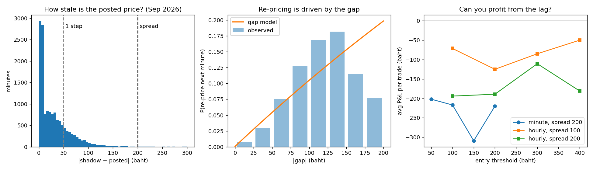
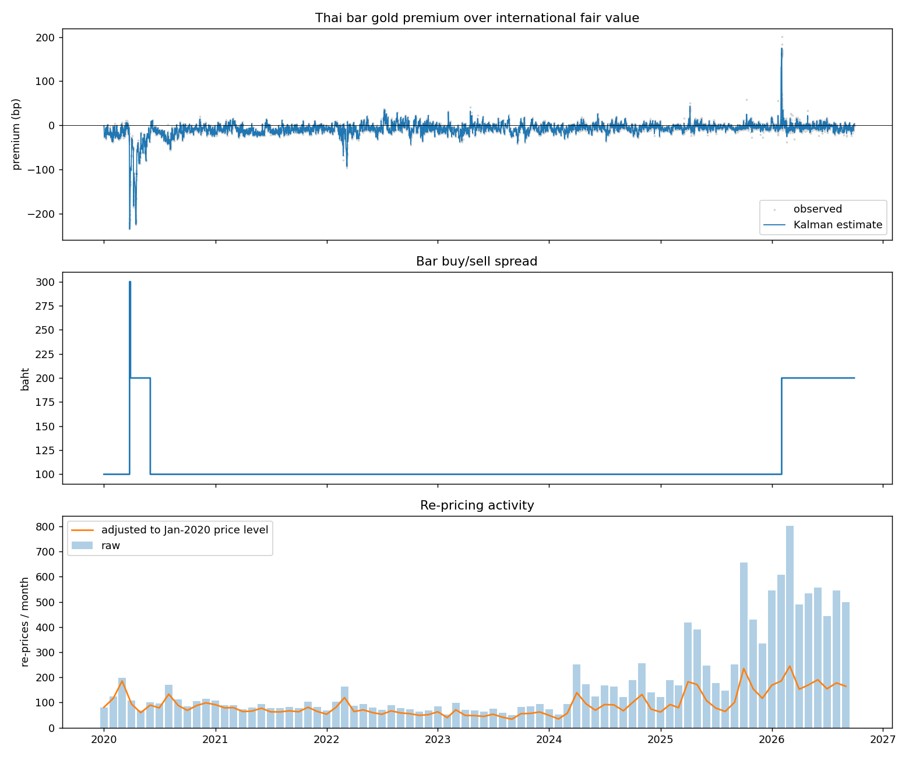

# Thai Gold Price Discovery

How out of date does Thailand's official gold price get, when does it update, and can anyone profit from the delay?

Almost every gold shop in Thailand uses one reference price set by the **Gold Traders Association**. That price only moves in **50-baht steps**, and only when the association announces a new round. World gold, meanwhile, moves every second. This project measures the resulting lag, models when the association re-prices, and tests whether the lag can be traded.

## Key findings

| Question | Answer |
|---|---|
| Does the Thai price follow world gold? | Almost mechanically. Observation noise around the conversion formula is **2.64 bp**, close to the **2.84 bp** that 50-baht rounding alone predicts. |
| How fresh are the association's inputs? | Its recorded gold prices match the live market within **~1 minute** (correlation 0.94). |
| How stale does the posted price get? | Median gap to fair value of **19 baht**. It exceeds one 50-baht step **21%** of the time, and the 200-baht spread only **0.13%** of the time. |
| Can you predict the next move's direction? | Yes: the sign of the gap predicts it **91%** of the time (513 re-prices). |
| Why do re-prices come in bursts? | A Hawkes model alone gives a branching ratio of **0.85**, but controlling for the price gap drops it to **0.05**. The bursts are the association chasing a fast market, not re-prices triggering each other. |
| Can the lag be traded? | No. A long-only strategy loses at every entry threshold, at minute and hourly resolution, under both 100- and 200-baht spreads. |



## Data

- **14,711 re-prices** (Jan 2020 – Sep 2026) scraped from the association's public API, each with bar buy/sell prices and the world gold price and USD/THB rate the association used.
- **World gold and USD/THB** from Yahoo Finance: 1-minute bars for September 2026 and hourly bars from May 2024.
- Cleaning flagged **7 data-entry errors** (e.g. gold recorded as $33,455 instead of ~$3,345): rows whose premium jumps more than 100 bp from the median of their 9 neighbours. Genuine market episodes persist across many rows, while typos do not.

## Method

**1. Fair value.** World gold converted into Thai units:

```
fair value = gold (USD/oz) × USD/THB × (15.244 g ÷ 31.1035 g) × 0.965
```

15.244 g is one baht-weight of bar gold, and Thai bars are 96.5% pure.

**2. Kalman filter for the premium.** The Thai price sits at a small, drifting premium to fair value. The log-premium is modelled as a random walk observed with noise at each re-price:

```
state:        p_t = p_{t-1} + w_t,   w_t ~ N(0, q·Δt)
observation:  z_t = p_t + v_t,       v_t ~ N(0, r)
```

`q` and `r` are fitted by maximum likelihood. Only re-price moments are used as observations, since a frozen posted price carries no new information. The filter was first validated on synthetic data with known parameters (`figures/kalman_validation_synthetic.png`).

**3. Shadow price and gap.** For every trading minute, the shadow price is the live fair value times the premium known at the last re-price (no look-ahead). The gap is shadow minus posted.

**4. Re-price timing.** On a 1-minute grid, re-price counts are modelled as Poisson with intensity

```
λ_t = μ + a·|gap_t|/50 + α·E_t,     E_t = e^{-β}(E_{t-1} + y_{t-1})
```

where `E_t` is a Hawkes excitation term (reset each trading day) and the branching ratio is `α e^{-β} / (1 − e^{-β})`. Three variants (gap only, Hawkes only, both) are compared by AIC: 3,703 / 4,140 / 3,694.

**5. Backtest.** Long-only, since retail buyers cannot short bars: buy at the posted sell price when the gap exceeds a threshold, sell at the posted buy price once the posted mid catches up (or at the close). Profit is roughly `gap − spread`, and gaps rarely exceed the spread.

## Other findings

- The premium is usually slightly negative and has shrunk from about −14 bp (2020) to −3 bp (2026), with two large episodes: up to **−235 bp during COVID** (Mar–Apr 2020) and **+175 bp on 2 Feb 2026**.
- The bar spread was 100 baht for most of the period, 300 then 200 during COVID, and **200 since 2 Feb 2026**.
- Re-prices per month rose **4.9×** from 2020 to 2026, but only **1.8×** after adjusting for the higher gold price, since a fixed 50-baht step is a smaller percentage move at higher prices.



## A bug worth mentioning

The first hourly backtest looked profitable. Yahoo labels each bar by its **start** time but reports its **closing** price, so the model was seeing prices up to an hour early. Shifting every bar's label to its end time removed all the profit.

## Limitations

- Minute-level results cover **September 2026 only**, because Yahoo serves 1-minute data for the last ~30 days.
- Yahoo's gold series is **futures** (`GC=F`), not spot. The Kalman premium absorbs the roughly constant basis.
- The backtest assumes instant execution at the posted price. Real execution would be worse.

## Repository structure

```
src/
  config.py              shared paths
  scrape_thai_gold.py    download re-price history from the association's API
  get_market_data.py     download world gold and USD/THB from Yahoo Finance
  kalman.py              Kalman filter + synthetic-data validation
  analyze_real_data.py   cleaning, premium history, spread and activity charts
  final_common.py        market alignment, look-ahead fix, minute grid
  hawkes.py              gap / Hawkes intensity models
  backtest.py            long-only lag-capture backtest
  final_results.py       lag, direction, timing models, backtests, final figure
data/                    CSVs (generated by the scripts; not committed)
figures/                 output charts
```

## How to run

```bash
python3 -m venv venv
source venv/bin/activate
pip install -r requirements.txt

python src/scrape_thai_gold.py      # ~5 min, writes data/thai_gold_reprices.csv
python src/get_market_data.py       # writes data/market_1m.csv and data/market_1h.csv
python src/analyze_real_data.py     # cleaning, Kalman premium, overview chart
python src/final_results.py         # timing models, backtests, final chart
python src/kalman.py                # optional: synthetic validation of the filter
```

Re-running `get_market_data.py` downloads the most recent ~30 days of minute data, so the minute-level numbers will reflect a different month than the ones above.
